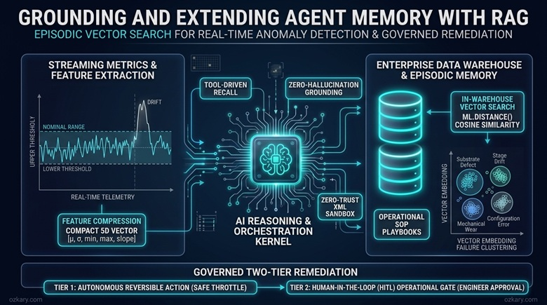

> Event Details
> - 🗓️ Date: Wednesday, Dec 2, 2026
> - 🕒 Time:  12:00 PM - 12:45 PM EST / EDT
> - 💻 Location: *Live YouTube Stream*

# Overview

Autonomous agents powered by Large Language Models (LLMs) are rapidly transforming how we analyze telemetry, monitor complex workflows, and predict operational failures. However, generic model weights alone are not enough for specialized domain workflows where true expertise comes from historical incident logs and past operational data. 

When specific historical context is missing, LLMs tend to hallucinate—providing plausible-sounding answers that do not apply to your actual process or machinery. 

In this session, we will explore how you can **ground** an agent's memory and supercharge its domain expertise by equipping it with **RAG (Retrieval-Augmented Generation)** tools. Learn how vector search bridges the gap between raw data streams and actionable historical knowledge, allowing agents to accurately diagnose drift, prevent costly hallucinations, and execute governed remediation safely.

> 👉 Join us and learn how to implement worker agents with RAG with production-proven design patterns, and walk away with the fundamental concepts you need to build resilient, production-ready AI systems!

📋 Presentation Agenda

- **Hallucination & Grounding:** Why stateless LLMs invent plausible-sounding fixes when operating without domain-specific historical memory, and how grounding resolves this.
- **RAG Fundamentals:** Exploring how RAG acts as an external knowledge retrieval engine capable of consuming diverse sources (text documents, operational logs, event histories, and structured records).
- **Beyond SQL:** Why traditional database queries fail to capture subtle, multi-variable drift in streaming data.
- **Vector Memory & Purpose:** How converting data into vector embeddings and similarity search allows agents to look up past historical incidents.
- **Agent Integration:** Grounding and extending agent memory to interpret context, invoke retrieval tools, and make informed decisions.
- **Use Case:** Detecting real-time patterns and process drift to identify maintenance needs, defects, and operational anomalies.
- **Conclusion & Impact:** How RAG prevents hallucinations, accelerates root-cause analysis, and hardens operational reliability.

## Why Attend?

- **Demystify Hallucinations:** Gain a clear understanding of why AI models invent answers and how architectural grounding stops it.
- **Practical Engineering Patterns:** Move beyond basic chatbot tutorials and learn production-grade patterns for agentic memory and tool use.
- **Real-World Impact:** See how combining vector search with automated workflows solves complex monitoring and diagnostics challenges.
- **Interactive Q&A:** Bring your questions and discuss architecture design directly with experienced systems and AI architects.

You’ll walk away from this practical session not just with an understanding of a new architecture, but with a clear pattern you can start using next week to build reliable, auditable, and production-ready data agents.  

## Who Should Attend

Students, software engineers, cloud architects, data engineers, AI developers, and anyone with an interest to learn about why hallucinations happen and how grounding techniques with RAG can help govern agent memory.

## Live YouTube Event

> [!TIP]
> Don't Forget to Register!

<iframe 
src="https://www.youtube.com/embed/MGziwOr-qxk" 
title="Live YouTube event - Grounding and Extending Agent Memory with RAG" frameborder="0" allow="accelerometer; autoplay; clipboard-write; encrypted-media; gyroscope; picture-in-picture; web-share" referrerpolicy="strict-origin-when-cross-origin" 
allowfullscreen>
</iframe>

<a href="https://www.youtube.com/live/ArDL2vEXnuA" target="_new" title="Click to watch on YouTube">Watch on YouTube or set a reminder</a>

## Stay Updated on Future Events

          

