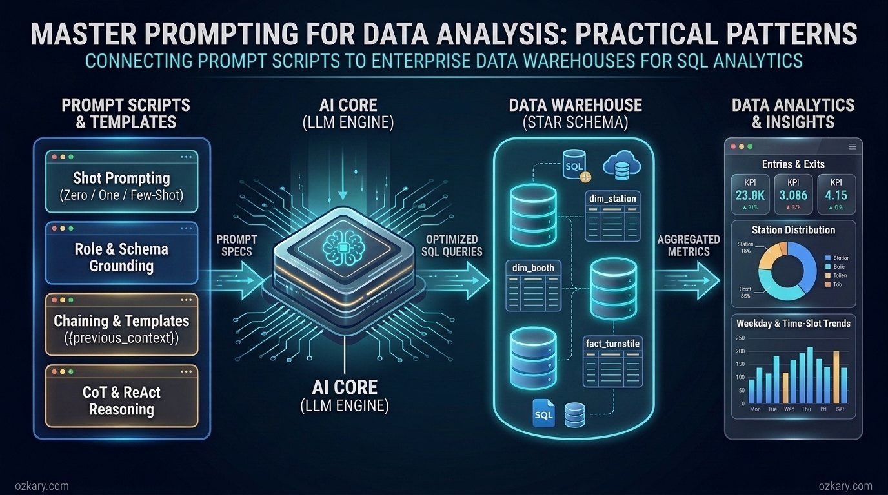
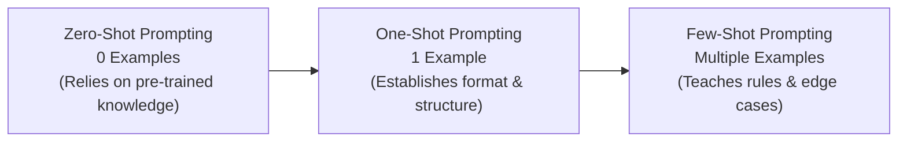

# Overview

Large Language Models (LLMs) have become a foundational technology in modern data engineering and analytics. By leveraging their natural language understanding and generative capabilities, data professionals can accelerate how they profile datasets, design data models, and write SQL queries against a Data Warehouse (DW). However, an LLM is only as effective as the instructions and context it receives. Without a structured approach, asking an AI model to analyze data often produces inconsistent queries, incorrect aggregations, or references to columns that do not exist.

In this post, we explore the technical specifications and architectural patterns of **prompting** and **prompt engineering** as they apply to data analysis. Our main objective is to understand how these prompting techniques work under the hood and how to use them to connect to a data warehouse and drive analytical tasks using SQL. As we cover each concept, we will illustrate the pattern with a concise prompt snippet using a consistent analytical context—querying station dimensions, commuter entry/exit measures, and time-slot distributions—so we can clearly see how each technique builds upon the last.



## 🚀 Featured Open Source Projects
Explore these curated resources to level up your engineering skills. If you find them helpful, a ⭐️ is much appreciated!

### 🏗️ [Data Engineering](https://github.com/ozkary/data-engineering-mta-turnstile) 
> **Focus:** Real-world ETL, Data Discovery, Data Warehousing & MTA Turnstile Data Analysis  
>  

### 🤖 [AI Agents (ADK)](https://github.com/ozkary/ai-engineering/tree/main/adk)
> **Focus:** LLM Patterns, Skills & Commands, and Agentic Workflows  
>  

### 📖 [Data Engineering Process Fundamentals](https://www.amazon.com/Data-Engineering-Process-Fundamentals-Hands/dp/B0CV7TPSNB)
> **Focus:** Architectural patterns, hands-on data pipelines, and MTA turnstile case studies  
> 

---

## Foundations of Prompting

Before we can apply advanced analytical frameworks, we need to understand the core mechanics of how foundation models process instructions and what makes a prompt effective for data analysis.

### What is a Prompt

A **prompt** is the structured input text sent to a foundation model to initiate a task, guide its reasoning, and define the expected output. In a technical sense, a prompt acts as the interface specification between the user and the LLM. Because foundation models are stateless by default, the prompt must carry all the necessary information required to complete the request within a single execution context (known as the **context window**).

When applying prompting to data analysis and SQL generation, a well-formed prompt specification typically consists of four components:

- **Instruction:** A clear directive stating the analytical task to perform (e.g., profiling data, identifying dimensions, or generating an aggregation query).
- **Context:** Background information that constrains the model, such as the target database system (e.g., Google BigQuery or SQL Server), table names, and business rules.
- **Input Data or Parameters:** The specific fields, schema definitions, filter criteria, or data samples to be evaluated.
- **Output Indicator:** The format and structure expected in the response, such as a SQL query, a Markdown table, or a list of observations.

> 👍 When interacting with LLMs for data analysis, using a low **temperature** setting (e.g., `0.0` to `0.2`) is recommended so the model produces deterministic, focused SQL rather than creative variations.

Let's look at a basic prompt snippet that illustrates these four components for a data discovery task:

```text
Instruction: Identify the dimensions, measures, and composite key from the provided dataset fields.
Context: We are performing data discovery on a transit turnstile dataset to prepare it for a data warehouse.
Input Fields: CA (Booth), UNIT (Remote), SCP (Device Address), STATION, DATE, TIME, ENTRIES, EXITS.
Output: Provide a bulleted list classifying each field as a Key, Dimension, or Measure.
```

While knowing the basic components of a prompt allows us to communicate with an LLM, writing a simple prompt is often not enough when working with large datasets and complex database schemas. To consistently generate accurate SQL and reliable analytical insights, we need to apply the discipline of prompt engineering.

---

### What is Prompt Engineering

**Prompt engineering** is the systematic process of designing, structuring, and refining prompts to optimize the accuracy, completeness, and performance of an LLM's output. In data analysis, prompt engineering moves us away from trial-and-error questions and toward a repeatable specification process.

When our goal is to connect to a Data Warehouse (an OLAP system) and perform data analysis with SQL, prompt engineering focuses on providing precise technical specifications so the model understands both the structure and the meaning of the data:

- **Schema and Relationship Specification:** Explicitly defining fact tables (which hold quantitative measures) and dimension tables (which hold descriptive attributes), along with the foreign keys used to join them.
- **Measure Behavior and Granularity:** Clarifying whether numeric fields are transactional values that can be summed directly or cumulative register values that require delta calculations across time intervals.
- **Query Performance Constraints:** Instructing the model to filter on partitioned columns (such as date/time fields) and group by clustered columns (such as station identifiers) to avoid costly full-table scans.
- **Data Quality Rules:** Specifying how the query should handle `NULL` values, duplicate records, or statistical outliers.

> 👍 Well-engineered prompts reduce token usage and prevent common SQL generation errors by giving the model explicit boundaries before it writes a single line of code.

The following prompt snippet shows how prompt engineering refines a general request into a precise technical specification for a Data Warehouse query:

```text
Generate a SQL query for our BigQuery Data Warehouse using the following technical specifications:
- Fact Table: fact_turnstile (partitioned by created_dt, clustered by station_id)
- Dimension Table: dim_station (station_id, station_name)
- Join Criteria: Inner join fact_turnstile and dim_station on station_id
- Measures: Calculate total entries (departures) and exits (arrivals)
- Constraints: Filter created_dt between '2023-03-01' and '2023-03-31', exclude rows where station_id is null, and group the results by station_name.
```

Providing clear technical specifications is the foundation of prompt engineering, yet there are many situations where describing a rule in plain text leaves room for ambiguity. When we want the model to follow a specific pattern or classification rule, we can guide its behavior by controlling how many examples we include in the prompt.

---

## In-Context Learning: Shot Prompting Patterns

In-context learning refers to a foundation model's ability to learn how to perform a task simply by observing examples provided within the prompt itself, without requiring any retraining or fine-tuning. Depending on the complexity of the analytical task, we use **Zero-Shot**, **One-Shot**, or **Few-Shot** prompting.



### Zero-Shot Prompting

**Zero-shot prompting** is asking a foundation model to complete a task with **no prior examples**, relying entirely on its pre-existing knowledge of programming languages, SQL syntax, and analytical concepts.

In data analysis, zero-shot prompting is most effective for standard, well-defined tasks where the model already understands the underlying pattern—such as writing basic SQL aggregations, explaining statistical concepts, or performing initial exploratory data profiling on familiar data types.

```text
Task: Write a SQL query to profile the `ext_turnstile` table during our discovery phase.
Requirements:
- Merge the separate `DATE` and `TIME` string columns into a single timestamp column named `created_dt`.
- Return the minimum date, maximum date, total row count, and the count of distinct `STATION` values.
```

Zero-shot prompting is fast and concise, making it a great starting point for standard SQL queries. However, when our analysis requires custom business formatting, such as grouping timestamps into specific multi-hour time slots with custom labels, a zero-shot prompt may guess the wrong format. To enforce a specific structure, we transition to one-shot prompting.

---

### One-Shot Prompting

**One-shot prompting** involves showing the foundation model **just one example** alongside the instructions, allowing it to learn the expected pattern and apply that knowledge to the remaining items in the task.

In data analysis, one-shot prompting is ideal when we need consistency in how data is categorized, labeled, or transformed in SQL. By supplying a single input-to-output mapping, we remove ambiguity about naming conventions, data casting, or interval logic without writing lengthy explanations.

```text
Task: Write a SQL CASE statement to categorize the hour of `created_dt` from `fact_turnstile` into 4-hour time slots for our analysis dashboard.

Use this single example as the pattern for all six 4-hour blocks in a 24-hour day:
Example Input: Hours 8 through 11 (8:00 AM to 11:59 AM)
Example Output: WHEN EXTRACT(HOUR FROM created_dt) BETWEEN 8 AND 11 THEN '08:00-11:59am'

Complete the SQL CASE expression for all six 4-hour time slots (starting at 12:00 AM) and group total `entries` and `exits` by `time_slot`.
```

While one-shot prompting is great for establishing a uniform structural pattern like a `CASE` statement, a single example cannot represent datasets that have multiple distinct variations or data quality exceptions. When the model needs to distinguish between several different data conditions, we expand to few-shot prompting.

---

### Few-Shot Prompting

**Few-shot prompting** provides the foundation model with **multiple examples** to learn from, helping it understand complex tasks, edge cases, and conditional rules to improve its performance.

During data cleaning and preprocessing, raw datasets often contain anomalies, missing audit events, or outliers that skew aggregations. Few-shot prompting allows us to show the model examples of valid records alongside specific types of bad data so it can generate SQL logic that filters or transforms each scenario accurately.

```text
Task: Write a SQL query that classifies turnstile audit records and calculates net `entries` deltas using the following examples:

Example 1 (Normal Scheduled Audit):
Input: DESC = 'REGULAR', prev_entries = 1000, current_entries = 1250
Expected Logic: Valid 4-hour increment -> return `current_entries - prev_entries` (250)

Example 2 (Recovered Missed Audit):
Input: DESC = 'RECOVR AUD', prev_entries = 1250, current_entries = 1250
Expected Logic: Duplicate recovery timestamp -> exclude record to prevent double-counting

Example 3 (Counter Reset Outlier):
Input: DESC = 'REGULAR', prev_entries = 50000, current_entries = 10
Expected Logic: Negative delta caused by hardware reset -> return NULL

Generate the SQL query for `fact_turnstile` that applies these rules across each device (`booth_id`, `scp`) ordered by `created_dt`.
```

Shot prompting patterns give us fine-grained control over how the model learns from examples, whether we need zero examples for quick profiling or several examples for complex data cleaning. Beyond showing the model examples of *what* to output, we can also improve analytical quality by shaping *who* the model acts as and grounding it in our schema specifications.

---

## Contextual and Behavioral Prompting Patterns

### Role Prompting

**Role prompting** is a technique used to guide the behavior, tone, and domain focus of an LLM by assigning it a specific **role or persona**.

In data analysis, different roles look at the exact same dataset through different lenses. For example, a **Data Engineer** focuses on table partitioning, incremental loads, and surrogate keys, whereas a **Business Analyst (BA)** focuses on summations, distributions across dimensions (like station or day of the week), and actionable KPIs for stakeholders. Assigning a role tells the model which analytical patterns and terminology to prioritize.

```text
Role: Act as a Senior Business Intelligence Analyst specializing in commuter traffic patterns and location-based marketing.
Context: In our data warehouse (`fact_turnstile` joined with `dim_station`), `exits` represent commuters arriving at a station area, and `entries` represent commuters departing from that location.
Task: Write a SQL query to identify the top 10 stations with the highest commuter arrivals during morning peak hours (08:00-11:59am), and explain how local businesses can use this distribution for geofencing advertisements.
```

Assigning a role aligns the model's analytical perspective with our business goals, but a persona alone does not give the model knowledge of our specific database tables. To ensure our SQL queries execute without schema errors, we pair role prompting with schema grounding.

---

### Schema Grounding and Metadata Specification

**Schema grounding** (often referred to as **context injection**) is the practice of embedding explicit data dictionary definitions, table relationships, and data types directly into the prompt so the model's responses are strictly anchored to your physical Data Warehouse schema.

When an LLM is asked to write SQL without schema grounding, it guesses table and column names based on generic conventions. By injecting the Star Schema metadata—extracted from our discovery and data modeling documentation—into the prompt, we constrain the model to use only verified entities and attributes.

```text
Schema Specification:
- Table `dim_station`: `station_id` (STRING, PK), `station_name` (STRING)
- Table `dim_booth`: `booth_id` (STRING, PK), `remote` (STRING), `booth_name` (STRING), `station_id` (STRING, FK)
- Table `fact_turnstile`: `log_id` (STRING, PK), `station_id` (STRING, FK), `booth_id` (STRING, FK), `scp` (STRING), `created_dt` (TIMESTAMP), `entries` (INTEGER), `exits` (INTEGER)

Rule: Use ONLY the tables and column names defined in the Schema Specification above.
Task: Write a SQL query that joins all three tables to return daily `entries` and `exits` by `station_name` and `booth_name`.
```

With role prompting and schema grounding in place, the model has both the right analytical perspective and accurate metadata for single queries. However, a complete data analysis process rarely happens in a single query; it progresses through multiple stages from discovery to final reporting. To manage multi-step workflows effectively, we use modular prompting patterns.

---

## Modular Workflow Patterns: Chaining and Reusing Prompts

### Prompt Chaining

**Prompt chaining** is a technique that breaks a complex analytical process into a sequence of smaller, interconnected prompts, where **the output of one prompt serves as the input for the next prompt**.

Attempting to perform data profiling, data cleaning, and multi-dimensional distribution analysis inside one massive prompt often leads to incomplete SQL or logic errors. By chaining prompts together, we mirror the natural stages of the data analysis process, validating each intermediate query before moving to the next step:

- **Step 1 (Discovery & Profiling Prompt):** Generate a SQL query to inspect date ranges, data types, and null values in the raw source.
- **Step 2 (Transformation & Cleaning Prompt):** Pass the validated findings from Step 1 into a second prompt to build a clean SQL view or Common Table Expression (CTE).
- **Step 3 (Distribution Analysis Prompt):** Use the CTE from Step 2 as the input to generate the final distribution queries by station, day of the week, and time slot.

```text
-- Prompt 1 (Base CTE Generation) --
Write a SQL CTE named `station_time_metrics` that joins `fact_turnstile` and `dim_station`, maps `created_dt` into the day of the week (`Sun` through `Sat`) and 4-hour `time_slot`, and aggregates `entries` and `exits`.

-- Prompt 2 (Chained Analysis Using Prompt 1 Output) --
Using the `station_time_metrics` CTE generated in the previous step, write two analytical SELECT queries:
1. A station distribution query returning the top 10 stations by total `exits`.
2. A day-of-week distribution query comparing total `entries` and `exits` across each `weekday`.
```

Prompt chaining gives us a structured, step-by-step pipeline for building complex SQL analyses. However, to execute a chain reliably in an automated or agentic workflow, we need a standardized mechanism to carry context from one step to the next—which brings us to reusing prompts with templates.

---

### Reusing Prompts (Prompt Templates)

**Reusing prompts** is the practice of abstracting proven prompts into parameterized **prompt templates** that can be stored under source control, shared across teams, and executed repeatedly by injecting dynamic variables and prior execution context at runtime.

In a simple reporting scenario, a template replaces hardcoded parameters (such as dates or station names) much like a Python function or a dbt Jinja macro. In a chained or **agentic data analysis workflow**, prompt templates play an even more critical architectural role: they act as **state containers** that automatically inject the output and observations from previous steps into the current prompt so the model maintains full continuity across the analytical process.

To keep injected context organized and prevent the LLM from confusing prior outputs with new instructions, templates rely on two types of **template tags**:

- **Variable Placeholder Tags (`{variable_name}`):** Dynamic tokens replaced at runtime by the application or orchestrator before the prompt is sent to the LLM. These carry both user parameters (e.g., `{dimension_column}`, `{measure_column}`, `{date_range}`) and state carried over from earlier steps (e.g., `{schema_metadata}`, `{previous_context}`, `{last_query_observation}`).
- **Structural Boundary Tags (`<tag>...</tag>`):** XML-style delimiter tags (such as `<schema_context>`, `<previous_context>`, and `<task>`) that wrap the injected variables. These boundary tags explicitly tell the model where historical context ends and where the current analytical instruction begins.

```text
Template Name: agentic_sql_analysis_step

Template Prompt:
Role: Senior Data Analyst connected to our BigQuery Data Warehouse.

<schema_context>
{schema_metadata}
</schema_context>

<previous_context>
Prior SQL CTE / Discovery Output:
{previous_context}

Latest Data Warehouse Observation:
{last_query_observation}
</previous_context>

<task>
Using the validated CTE in <previous_context>, write a SQL query to analyze `{measure_column}`
grouped by `{dimension_column}` for `created_dt` between '{start_date}' and '{end_date}'.
Current Objective: {current_analysis_goal}
</task>
```

Let's review how the template tags work together in this specification:
- `{schema_metadata}` inside `<schema_context>`: Injects the verified table definitions (`fact_turnstile`, `dim_station`, `dim_booth`) discovered at the start of the workflow so every step stays grounded.
- `{previous_context}` inside `<previous_context>`: Carries forward the SQL CTE or profiling summary generated by the previous link in the prompt chain.
- `{last_query_observation}`: Injects the sample rows, row counts, or error messages returned by the Data Warehouse from the prior query execution.
- `{measure_column}`, `{dimension_column}`, `{start_date}`, `{end_date}`, and `{current_analysis_goal}` inside `<task>`: Inject the specific analytical parameters for the current step (for example, analyzing `exits` across `time_slot` to identify peak commuter arrival windows).

By combining structural boundary tags with dynamic variable placeholders, reusable prompt templates provide the backbone for multi-step agentic workflows. Once our templates can carry state from one step to the next, we can pair them with reasoning and execution frameworks that allow the model to think and query the database autonomously.

---

## Reasoning and Agentic Frameworks

When an analytical task requires multi-step logic, statistical validation, or interactive querying against a live Data Warehouse, standard prompting patterns may jump to conclusions too quickly. Frameworks like **Chain-of-Thought (CoT)** and **ReAct** structure how the model thinks and acts before delivering an answer.

### Chain-of-Thought (CoT) Prompting

**Chain-of-Thought (CoT) prompting** is a technique that instructs the foundation model to break down a complex problem into explicit, sequential reasoning steps before generating the final output or SQL code.

In data analysis, writing a query that combines window functions (`LAG`), statistical metrics (like Z-scores or correlation preparations), and multi-level groupings is error-prone if the model writes the SQL immediately. By asking the model to explain its analytical logic step-by-step first, each reasoning step conditions the next, resulting in much more accurate SQL.

```text
Task: Write a SQL query to identify outlier stations where morning arrivals (`08:00-11:59am` exits) differ significantly from evening departures (`04:00-7:59pm` entries) using a Z-score threshold of 1.95.

Let's think step-by-step before writing the SQL query:
1. First, explain how to filter and aggregate mean morning `exits` (arrivals) and mean evening `entries` (departures) per `station_name`.
2. Second, define the mathematical formula for the difference and standard deviation across stations to compute the `z_score`.
3. Third, explain how to filter for outlier stations where `ABS(z_score) > 1.95`.
4. Finally, generate the complete SQL query using CTEs that correspond to steps 1 through 3.
```

Chain-of-Thought is highly effective for planning complex SQL and statistical logic in a single response. However, CoT relies solely on internal reasoning without inspecting live data in the database. When we need the model to test a hypothesis by running a query, observing the actual results from the Data Warehouse, and deciding the next step dynamically, we use the ReAct framework.

---

### ReAct (Reason + Act) Prompting

**ReAct (Reason and Act)** is a framework where the foundation model interleaves verbal reasoning (**Thought**) with external tool execution (**Action**) and data inspection (**Observation**) in a continuous loop until it solves the analytical problem.

In an AI-assisted data warehouse environment, a ReAct workflow connects the LLM to a database execution tool. Instead of guessing why a metric looks unusual, the model reasons about what to check, runs a diagnostic SQL query, reads the returned rows, and refines its analysis based on real evidence:

- **Thought:** The model formulates a hypothesis or identifies what data it needs to inspect next.
- **Action:** The model invokes a tool (e.g., executing a `SELECT` query against the Data Warehouse).
- **Observation:** The system returns the query results from the database back to the model.

```text
Instruction: You have access to a `run_sql_query` tool connected to our Data Warehouse. Use the Thought -> Action -> Observation loop to answer the analytical question.

Question: Is there a statistically significant difference between weekday and weekend commuter arrivals (`exits`) at top stations in July?

Thought 1: First, I need to query `fact_turnstile` and `dim_station` for July to inspect the top 10 stations by total `exits` and verify there are no missing dates or null values.
Action 1: run_sql_query("SELECT s.station_name, COUNT(DISTINCT DATE(f.created_dt)) AS days_recorded, SUM(f.exits) AS total_exits FROM fact_turnstile f JOIN dim_station s ON f.station_id = s.station_id WHERE EXTRACT(MONTH FROM f.created_dt) = 7 GROUP BY s.station_name ORDER BY total_exits DESC LIMIT 10")
Observation 1: [Returns 10 stations, all with 31 days recorded].
Thought 2: Now that data completeness is verified, I will write a query comparing average daily `exits` on weekdays (Mon-Fri) versus weekends (Sat-Sun) for these top 10 stations.
Action 2: run_sql_query("... [Weekday vs Weekend Aggregation SQL] ...")
```

Frameworks like Chain-of-Thought and ReAct elevate LLMs from simple text generators into analytical reasoning engines. To complete our workflow and ensure that the SQL queries and insights produced by these frameworks are ready for production dashboards, we apply one final set of verification and output patterns.

---

### Self-Critique and Structured Output Prompting

When integrating AI-generated analysis into automated pipelines or Business Intelligence (BI) dashboards, two additional prompting techniques ensure reliability:

- **Self-Critique (Verification) Prompting:** Instructing the model to review and validate its own generated SQL query against a checklist of best practices—such as verifying partition filters, checking join keys, and confirming division-by-zero protection—before finalizing the output.
- **Structured Output Prompting:** Constraining the model to return its analytical results in a strict, machine-readable format (such as JSON, CSV, or a standardized Markdown table) so visualization tools and applications can consume the output directly.

```text
Task: Review the SQL query we generated for station time-slot distributions and return the final validated result in JSON format.

Verification Checklist:
1. Ensure `created_dt` is used in the WHERE clause to utilize table partitioning.
2. Confirm all 6 four-hour time slots are ordered chronologically from 12:00am to 11:59pm.

Output Format: Return a JSON object with keys `is_valid` (boolean), `optimization_notes` (string), `validated_sql` (string), and `recommended_chart_type` (string).
```

By combining verification checks with structured outputs, we close the loop between exploratory prompting and production-ready data analysis.

---

## Summary

Prompt engineering is a core competency for modern data analysis, providing a structured methodology to translate business questions into accurate, performant Data Warehouse queries. Rather than relying on ad-hoc questions, selecting the right prompting pattern allows us to control how foundation models interpret schemas, handle data quality nuances, and reason through complex SQL logic:

| Prompting Pattern | Technical Purpose in Data Analysis |
| --- | --- |
| **Prompt & Prompt Engineering** | Defines the core instruction, schema context, constraints, and expected output format for Data Warehouse queries. |
| **Zero-Shot Prompting** | Leverages pre-trained model knowledge for standard SQL queries and initial data discovery without examples. |
| **One-Shot Prompting** | Uses a single example to enforce consistent formatting, labeling, or SQL `CASE` categorization (such as time slots). |
| **Few-Shot Prompting** | Provides multiple examples to teach pattern recognition, data cleaning rules, and outlier handling. |
| **Role Prompting** | Assigns a domain persona (e.g., Business Analyst or Data Engineer) to guide analytical focus and terminology. |
| **Schema Grounding** | Injects verified table and column metadata from the Data Warehouse to prevent schema hallucinations. |
| **Prompt Chaining** | Connects sequential prompts so discovery outputs feed transformation CTEs and final distribution analyses. |
| **Reusing Prompts (Templates)** | Uses structural boundary tags (`<previous_context>`) and variable placeholders (`{previous_context}`, `{dimension_column}`) to carry state across agentic steps and parameterize queries. |
| **Chain-of-Thought (CoT)** | Breaks down multi-step SQL logic and statistical calculations sequentially before generating code. |
| **ReAct Framework** | Combines reasoning (`Thought`) with live database queries (`Action`) and result inspection (`Observation`). |
| **Self-Critique & Structured Output** | Validates SQL against performance/quality rules and formats results into JSON or tables for BI tools. |

### Hands-on Resources

To see the data engineering and data analysis concepts referenced in the prompt snippets above in action, explore these hands-on project folders:

- 👉 [Data Engineering Process - Step 1: Discovery](https://github.com/ozkary/data-engineering-mta-turnstile/tree/main/Step1-Discovery)
- 👉 [Data Engineering Process - Step 5: Data Analysis and Visualization](https://github.com/ozkary/data-engineering-mta-turnstile/tree/main/Step5-Analysis)

---

## 🌟 Let's Connect & Build Together
Thanks for reading! 😊 If you found these architectural patterns helpful, let's connect and continue the conversation:

* **[GDG Broward](https://gdg.community.dev/gdg-broward-county-fl/)**: Join our local dev community for workshops and live tech sessions.
* **[Global AI Events](https://globalai.community/chapters/jacksonville/)**: Connect with the community across global AI events.
* **[LinkedIn](https://www.linkedin.com/in/oscardgarcia)**: Follow along for regular deep dives into software architecture and AI engineering.
* **[GitHub](https://github.com/ozkary)**: Explore open-source projects, agents, and samples.
* **[YouTube](https://www.youtube.com/@ozkary)**: Watch recordings and step-by-step video tutorials.
* **[BlueSky](https://bsky.app/profile/ozkary.bsky.social)** / **[X / Twitter](https://x.com/ozkary)**: Daily tech updates and architectural tips.

👉 *Originally published at [ozkary.com](https://www.ozkary.com)*
