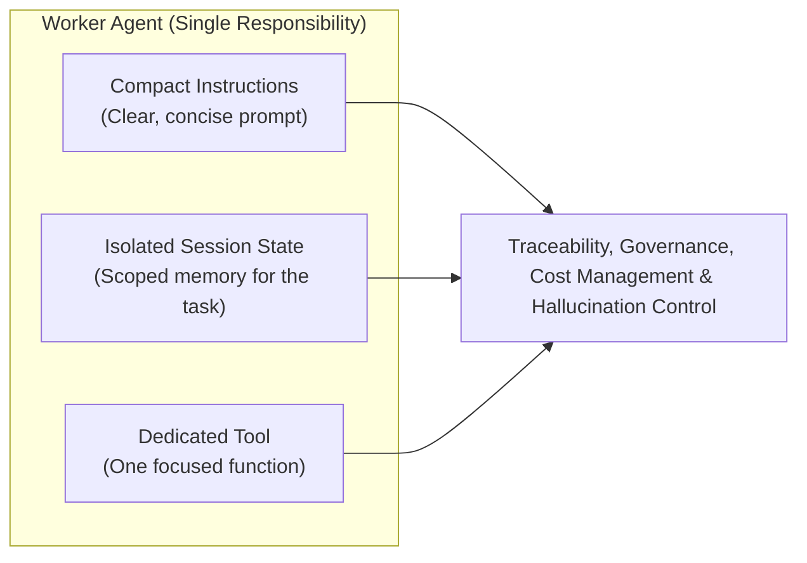
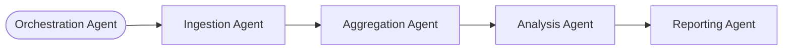
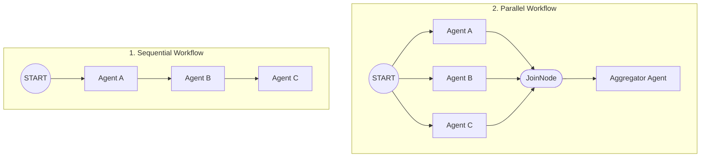
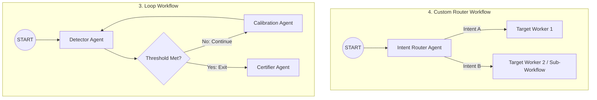

# Overview

What is **Smart Orchestration**, and how do we apply it to multi-agent systems? If you have built data flows or data pipelines, you already understand the purpose of orchestration: executing a series of connected steps with gates or signals that determine whether to continue or halt the process. When we bring AI into orchestration, we need to combine that same deterministic control with an agent's ability to reason and act.

As organizations adopt generative AI, however, many teams jump straight into building solutions without process definitions or software architecture principles, falling into two critical anti-patterns:

- **The Monolithic Agent Trap:** Putting everything into one single agent or tool—much like putting an entire software project into a single function or class. This causes **prompt overload** (mixing instructions for every possible task into one prompt), **tool confusion** (attaching dozens of database, API, and custom logic functions to one agent, which triggers hallucinations from picking the wrong tool), **governance and auditing difficulties** (making it hard to debug or audit what went wrong), and **high token costs and slow execution** from repeatedly sending massive context to the Large Language Model (LLM).
- **The Spaghetti Code Trap:** Realizing that a single monolithic agent does not scale and creating multiple agents, but stitching them together with brittle conditional logic (`if/else` statements) or uncontrolled chat loops. Hardcoding `if this happens, do that` strips away the agent's power to reason and react, while unstructured agent chat loops lose deterministic execution.

**Smart Orchestration** resolves both traps by pairing focused, single-purpose **Worker Agents** with structured **Workflow Graphs**—anchoring autonomous AI execution within deterministic enterprise controls.


## 🚀 Featured Open Source Projects
Explore these curated resources to level up your engineering skills. If you find them helpful, a ⭐️ is much appreciated!

### 🤖 [AI Agents (ADK)](https://github.com/ozkary/ai-engineering/tree/main/adk/workflow_agent)
> **Focus:** LLM Patterns, Multi-Agent Workflows, and Worker Agents  
>  

### 🏗️ [Data Engineering](https://github.com/ozkary/data-engineering-mta-turnstile) 
> **Focus:** Real-world ETL & MTA Turnstile Data  
>  

### 📖 [Data Engineering Process Fundamentals](https://www.amazon.com/Data-Engineering-Process-Fundamentals-Hands/dp/B0CV7TPSNB)
> **Focus:** Architectural patterns, hands-on data pipelines, and MTA turnstile case studies  
> 

---
💡 **Contribute:** Found a bug or have a suggestion? Open an issue and be part of the open-source project.

## 🔗 Related Repository: AI Engineering Workflows
Explore the full implementation of the worker agents and orchestration workflows used in this session:  
**[https://github.com/ozkary/ai-engineering/tree/main/adk/workflow_agent](https://github.com/ozkary/ai-engineering/tree/main/adk/workflow_agent)**

## YouTube Video

<iframe width="560" height="315" src="https://www.youtube.com/embed/ArDL2vEXnuA" title="Smart Orchestration: Multi-Agent Systems and Workflows" frameborder="0" allow="accelerometer; autoplay; clipboard-write; encrypted-media; gyroscope; picture-in-picture; web-share" referrerpolicy="strict-origin-when-cross-origin" allowfullscreen></iframe>

> 👍 Subscribe to the channel to get notified on new events!

## 📋 Presentation Agenda

- **Agent Anatomy: The Single-Purpose Worker** — Applying the Single Responsibility Principle: scoping one focused agent to one bounded task, lean context, and specific toolset.
- **The Multi-Worker Advantage: Why Decouple?** — Eliminating monolithic bottlenecks through cognitive division of labor, isolated database permissions, and zero-trust security boundaries.
- **Workflow Orchestration: Moving Beyond Agent Chat** — Replacing open-ended conversational loops with deterministic state graphs that guarantee execution order, typed state handoffs, and circuit-breaker fault handling.
- **Core Enterprise Workflow Patterns** — Architectural breakdown of four production graph topologies: Sequential chains, Parallel fan-out/fan-in, Evaluator-Optimizer loops, and Dynamic intent routing.
- **Live Walkthrough: Agent Workflows in Action** — End-to-end execution of a multi-agent workflow querying a data warehouse and delivering analytical results.
- **Key Takeaways** — Summary of the core principles and Q&A points discussed in the session.

---

Now that we understand the problems with monolithic agents and spaghetti conditional logic, how do we start designing multi-agent orchestration the right way? Let's start by looking at how an individual Worker Agent works.

## Agent Anatomy: The Single-Purpose Worker

In software development, it is a foundational best practice to build classes and worker tasks that focus on doing one thing well. The exact same principle—the **Single Responsibility Principle (SRP)**—applies to AI agents. Instead of building one agent that tries to do everything, we build a **Worker Agent** that has a single responsibility.



Scoping a Worker Agent to a single responsibility provides four major engineering benefits:

1. **Clear, Compact Instructions:** Instructions are the prompts we pass to the agent telling it what it does, what capabilities it has, and to be concise and exact without hallucinating. Because the worker focuses on one task, its instructions remain compact. Every time an agent runs, the LLM must read and process those instructions—so keeping prompts small directly lowers token usage and **manages cost** while making it easy to see where an agent fails and audit its behavior.
2. **Isolated Session State:** Session state is the working memory that enables an agent to understand what is happening and recall previous steps executed during the run. A single-purpose worker isolates its session state so it only holds the data and context relevant to its specific responsibility—not everything happening across the entire workflow. Once the one-time session finishes, that ephemeral memory is flushed out.
3. **Dedicated Tools:** Instead of equipping an agent with ten different tools to call APIs, query databases, and read data lakes, a worker agent is given a **dedicated tool**—just the one function it needs to perform its specific activity.
4. **Traceability and Governance:** By keeping the worker's footprint isolated and focused, we gain full traceability, cost management, easier testing, and tight control over hallucinations.

That is the foundation of our building block. Now that we understand what an individual Worker Agent is, what is the advantage of having multiple worker agents instead of a monolith? Let's look at why we decouple.

---

## The Multi-Worker Advantage: Why Decouple?

When we decouple a monolithic agent and create multiple specialized workers, we unlock the **Multi-Worker Advantage** for agent orchestration:

- **Domain Knowledge and Context Isolation:** By creating specialized workers, we isolate both the domain knowledge and the execution context. If a worker's focus is to call a specific API based on its reasoning, that is all it knows. If another worker's job is database access—querying a table or a view—it is focused exclusively on that database task. Because it does not have a Google search tool attached to it, it is never going to wander off, run an internet search, and return unverified results. This isolation protects the pipeline from cross-tool confusion and hallucinations.
- **Modularity and Easy Testing:** By breaking a complex problem into smaller units of work, we can isolate each worker module, inject its specific instructions and tools, and test it independently—which is the end goal of clean software design.

### How Multiple Workers Connect: The Orchestration Graph

Once we have multiple specialized workers, how do they fit together? They are coordinated through an **Orchestration Graph**:



In this architecture, an **Orchestration Agent** is responsible for loading and coordinating the workflow. Based on the request and metadata, it loads the workflow graph—which is a connected series of Worker Agents. Every node in the graph is a single-responsibility Worker Agent that executes its specific task and hands off to the next node.

Now that we know how a workflow is structured conceptually using multiple workers, what does it look like when we build it in code with an SDK—and what makes it different from simply hardcoding `if` statements? Let's examine Workflow Orchestration.

---

## Workflow Orchestration: Moving Beyond Agent Chat

In traditional procedural code, developers often write conditional statements like `if result == True: call_next_function()`. In agent development, we want to stay away from hardcoding brittle conditional ladders and instead use an **orchestration engine** that connects a series of Worker Agents using **Composition**.

Using a workflow graph gives us **deterministic handoffs (gates)**:
- When one Worker Agent finishes executing, it writes its result to a defined output key in the session state.
- Depending on the workflow definition, the downstream agent reads that output and deterministically decides whether to execute its step or stop immediately if there was a failure.
- We achieve this by composing the workflow graph declaratively—defining the starting point and the **edges** that connect each agent node.

### Defining a Worker Agent and Workflow Graph in Python (Google ADK)

Here is how this looks in Python using the **Google Agent Development Kit (ADK)** (`workflow_agent/workflows/sequential.py`):

```python
from google.adk.workflow import Workflow, START
from worker_agent import WorkerAgent

# 1. Instantiate a single-responsibility WorkerAgent with instructions, tool, and output_key
ingestion_agent = WorkerAgent(
    name="IngestionAgent",
    instruction="Identify the target geographic zone and call query_zone_commuters once.",
    tools=[query_zone_commuters],
    output_key="raw_telemetry",
).agent

aggregation_agent = WorkerAgent(
    name="TimeSlotAggregatorAgent",
    instruction="Call calculate_time_slots once to aggregate observations into time slots.",
    tools=[calculate_time_slots],
    output_key="slotted_telemetry",
).agent

# 2. Compose the orchestration graph using edges
workflow = Workflow(
    name="mta_sequential_geo_pipeline",
    edges=[
        (START, ingestion_agent),
        (ingestion_agent, aggregation_agent),
        (aggregation_agent, peak_agent),
        (peak_agent, reporter_agent),
    ],
)
```

Notice how clean this composition is:
- Each `WorkerAgent` declares its `instruction`, its dedicated tool (`query_zone_commuters`), and its `output_key` (`"raw_telemetry"`), which the next agent in the chain uses to continue the process.
- The `Workflow` object defines the `edges`—telling the orchestration engine to start at `START`, call `ingestion_agent`, then transition from `ingestion_agent` to `aggregation_agent`, and so on.

### The Deterministic Gate Contract: `{status, message, data}`

In multi-agent systems, unhandled errors and unstructured responses cause upstream failures to cascade into downstream agents, leading to hallucinations and conversational drift. To prevent brittle `if/else` ladders while guaranteeing safe execution, every tool and worker task in the architecture adheres to a uniform envelope:

```python
{
    "status": True,             # Boolean flag: True on success, False on failure/error
    "message": "Description",   # Human-readable status or diagnostic message
    "data": { ... }             # Structured payload written to the agent's output_key
}
```

This contract acts as an automated **circuit breaker**:
- **On Success (`status: True`):** The orchestration engine writes the `data` payload to session state under the designated `output_key` and signals the next agent node to run.
- **On Failure (`status: False`):** Downstream execution halts immediately, and the diagnostic `message` is logged for governance and debugging—preventing corrupt or missing data from triggering downstream hallucinations.

Now that we understand how to create a workflow graph in code, what types of workflows exist, and what is the purpose of each one? Let's review the four core enterprise workflow patterns.

---

## Core Enterprise Workflow Patterns

There are four foundational architectural patterns for composing agents to execute enterprise business flows. These patterns apply across software engineering and map directly to multi-agent orchestration:




### 1. Sequential
Just as the name implies, a **Sequential** workflow is a linear series of steps: $A \rightarrow B \rightarrow C \rightarrow D$. If $A$ runs and succeeds, $B$ runs; if $B$ succeeds, $C$ runs, and so on. Every node executes in strict linear order as long as each prior step completes cleanly.

### 2. Parallel
In a **Parallel** workflow, worker agents do not run in series—they run **independently and simultaneously** to execute tasks, and an aggregator puts their findings together for the final output. You use parallel execution when you need multiple agents to fetch or analyze data from different sources or regions at the same time (for example, querying an internal database, calling an API, or analyzing separate geographic zones concurrently) and then joining those results once all parallel branches finish.

### 3. Loops
A **Loop** workflow repeats worker activities until a threshold or condition (a marker) is met. The marker tells the workflow either that it has reached its maximum number of repetitions or that it has achieved the target value it was looking for—such as a calibration task that iteratively calibrates a process until it reaches a stable quality condition.

### 4. Custom Router
A **Custom Router** is a more advanced pattern that uses **user intent** to dispatch queries to a specific target. Based on what the user is asking for, the router agent determines which specialized worker agent (or which sub-workflow) to call—for example, deciding whether to route a request to an external search worker or an internal inventory system worker.

Furthermore, **all of these patterns can be orchestrated together**: a master orchestrator can route to a parallel workflow, which in turn can invoke a sequential workflow.

Now that we understand the four workflow patterns and how they work conceptually, let's see how this works live with a real data warehouse use case.

---

## Review Agent Workflows Code (Live Walkthrough)

### 1. Background & Use Case: Data Warehouse Analytics Beyond Static Dashboards

In our live walkthrough, we execute a multi-agent workflow that performs Business Intelligence (BI) and commuter analytics against a **Google BigQuery** data warehouse. This use case is built on the NYC Metropolitan Transportation Authority (MTA) subway turnstile system from the book [*Data Engineering Process Fundamentals*](https://www.amazon.com/Data-Engineering-Process-Fundamentals-Hands/dp/B0CV7TPSNB) and the [`data-engineering-mta-turnstile`](https://github.com/ozkary/data-engineering-mta-turnstile) repository.

In a traditional BI setup, we visualize turnstile traffic and total station entries/exits using dashboards in tools like **Looker** or **PowerBI**. Dashboards are great for viewing standard charts, but when you want to dig deeper into a specific station or geographic zone—for example, understanding peak commuter surges and resource needs for Midtown Manhattan or Lexington Station—you traditionally have to manually write SQL queries and Python scripts.

Our goal in this walkthrough is to use **AI Agent Workflows** to dig into the data warehouse and perform that deeper geo-fencing and commuter mobility analysis automatically on demand.

### 2. Reviewing the Code in Visual Studio Code

All of the code resides in the [`ai-engineering`](https://github.com/ozkary/ai-engineering/tree/main/adk) repository under the `adk` directory (`worker_agent` and `workflow_agent`). Walking through the implementation in VS Code reveals how the architecture is structured:

#### The Foundational Building Block: `WorkerAgent` (`worker_agent/agent.py`)
At the top of our hierarchy is `WorkerAgent`, which inherits from `BaseAgent`:

```python
class WorkerAgent(BaseAgent):
    """
    Specialized worker agent derived from BaseAgent.
    Abstracts model resolution and framework primitives from workflow sub-agents.
    """
    def __init__(
        self,
        name: str,
        instruction: str = "",
        instructions: str = "",
        tools: Optional[List[Any]] = None,
        output_key: Optional[str] = None,
        **kwargs,
    ):
        resolved_instruction = instruction or instructions
        kwargs["name"] = name
        kwargs["instruction"] = resolved_instruction
        super().__init__(**kwargs)

        self.tools = tools or []
        self.output_key = output_key
        self.agent = self.build_agent()
```

Using object-oriented inheritance, `BaseAgent` handles centralized platform internals—such as which LLM model to use and platform-wide rules—while `WorkerAgent` isolates each worker's single instruction, dedicated tools, and `output_key`.

#### The Orchestrator: `WorkflowAgent` & `WorkflowFactory` (`workflow_agent/agent.py`)
Next, in the `workflow_agent` folder, `WorkflowAgent` acts as our orchestrator:
- **Security via Inheritance (`SecuredToolAgent`):** `WorkflowAgent` inherits from `SecuredToolAgent`, which reads instructions and applies cryptographic signature verification (`.signed.md`) to ensure prompt instructions have not been tampered with or exploited.
- **Strategy Resolution via `WorkflowFactory`:** Instead of using hardcoded `if/else` conditions to pick a workflow, `WorkflowAgent` calls `WorkflowFactory` (`factory.py`) to resolve the active strategy (`sequential`, `parallel`, `loop`, or `custom`) from metadata and build the workflow graph dynamically.

#### Inside the Workflow Definitions (`workflow_agent/workflows/`)
Inside the `workflows/` folder, each pattern is cleanly encapsulated in its own module:

- **Sequential (`sequential.py`):** `build_sequential_agent` instantiates the four `WorkerAgent` instances in memory (`IngestionAgent`, `TimeSlotAggregatorAgent`, `PeakWindowAnalyzerAgent`, and `GeoBriefingReporterAgent`)—each with its own instruction, tool, and `output_key`—and chains them together in `Workflow(edges=[...])`:
  ```python
  return Workflow(
      name="mta_sequential_geo_pipeline",
      description="Executes serial data operations from BigQuery turnstile telemetry to executive geo-zone mobility reports via ADK Workflow.",
      edges=[
          (START, ingestion_agent),
          (ingestion_agent, aggregation_agent),
          (aggregation_agent, peak_agent),
          (peak_agent, reporter_agent),
      ],
  )
  ```
- **Parallel (`parallel.py`):** `build_parallel_agent` instantiates regional worker agents (`MidtownZoneAnalyst`, `QueensZoneAnalyst`, `DowntownFinancialZoneAnalyst`) and wires them to run concurrently from `START`. Just like asynchronous promises spinning off in parallel, a `JoinNode(name="merge_zones")` waits for all three regional analysts to come back and joins their outputs before calling `CrossZoneGeoSynthesizer`:
  ```python
  join_node = JoinNode(name="merge_zones")

  return Workflow(
      name="mta_parallel_workflow_suite",
      edges=[
          (START, (midtown_analyst, queens_analyst, downtown_analyst)),
          ((midtown_analyst, queens_analyst, downtown_analyst), join_node),
          (join_node, merger_agent),
      ],
  )
  ```
- **Loop (`loop.py`) and Custom Router (`custom.py`):** `build_loop_agent` connects the anomaly detector (`ZScoreAnomalyDetector`) to an evaluation condition (`evaluate_quality_route`) that checks whether the data quality confidence threshold has been met—continuing the calibration loop with `SpatialImputerAgent` or exiting to `GeoQualityCertifierAgent` once the condition is reached.

### 3. Running the Workflow Live

You can run the workflow agents using the ADK web UI, the standard ADK CLI (`uv run adk run workflow_agent`), or interactively using **Google Antigravity** (a CLI code assistant that can execute CLI commands and format the agent output cleanly for interactive evaluation). In a production environment, automated pipeline triggers invoke the CLI command directly with the target prompt.

When we load `workflow_agent` running the `sequential` strategy and pass the user intent prompt:

```text
Analyze the peak commuter flow for Midtown Manhattan
```

the workflow uses its domain skills to understand the business concepts and executes each `WorkerAgent` step in sequence against BigQuery:

1. **Ingestion (`IngestionAgent`):** Queries BigQuery to fetch the turnstile observations for the Midtown Manhattan stations (`59 ST`, `34 ST-HERALD SQ`, `GRD CNTRL-42 ST`, `34 ST-PENN STA`).
2. **Slot Aggregation (`TimeSlotAggregatorAgent`):** Aggregates the station traffic across the canonical time slots (`morning_rush`, `afternoon_midday`, `evening_rush`).
3. **Peak Window Analysis (`PeakWindowAnalyzerAgent`):** Evaluates the morning rush and evening rush surges and determines the zone's directional mobility profile.
4. **Executive Bulletin (`GeoBriefingReporterAgent`):** Produces the final **Geo-Zone Commuter Mobility Bulletin** with operational insights:

```text
================================================================================
NYC TRANSIT GEO-ZONE COMMUTER MOBILITY BULLETIN
================================================================================
Target Zone          : Midtown Manhattan (ZONE_MIDTOWN_COMMERCIAL)
Monitored Stations   : 59 ST, 34 ST-HERALD SQ, GRD CNTRL-42 ST, 34 ST-PENN STA
Spatial Profile      : Commercial / Employment Destination (Inflow Heavy)
Net Direction Ratio  : 1.84 (Morning Inbound / Outbound)
--------------------------------------------------------------------------------
[Peak Mobility Windows]
  • Peak Arrival Influx:    Morning Rush (08:00 - 11:00)
  • Peak Departure Outflow: Evening Rush (16:00 - 20:00)

[Operational Dispatch Directive]
  • Allocate maximum turnstile entry-gate throughput during 'evening rush'.
  • Schedule location-based dynamic messaging near station exits during 'morning rush'.
================================================================================
```

Instead of manually slicing charts in a dashboard, the interactive multi-agent workflow queries the data warehouse and immediately delivers operational insights—helping teams manage resources, anticipate bottlenecks, and schedule geofenced activities.

> [!TIP]
> **Bonus VS Code Plugin — Code Lineage:** When analyzing your files and class inheritance structures in Visual Studio Code, check out the **Code Lineage by ozkary.com** extension in the VS Code Marketplace (written and published by Oscar Garcia). It generates a visual view of how your classes and code files connect.

Now that we have seen the code and live execution in action, let's recap our key takeaways and review the questions answered during the session.

---

## Key Takeaways

### Core Principles to Remember

- **Use Worker Agents to Isolate Context, Tooling, and Instructions:** Keep each worker focused on a single responsibility with compact instructions, isolated session state, and dedicated tools. This makes your agents easy to manage, easy to test, easy to audit, and cost-effective to run.
- **Monitor and Continuously Refactor:** As you build out your worker agents and orchestration workflows, monitor how they grow. If you notice you have overbuilt a Worker Agent and it is doing more than it needs to do, **refactor it**—break it down into another worker agent to keep each agent's footprint small. Likewise, if a workflow grows too complex or needs a different execution path, refactor it into separate, composable workflows.

### Session Q&A Highlights

1. **How do you control the process of Worker Agents via a Loop?**  
   Think of a Loop workflow just like a loop in standard code: it relies on a matching exit condition (for example, iterating from 1 to 10, or repeating until a specific condition is true). In our code (`loop.py`), the workflow calls an evaluation function after each pass that checks those exit conditions (`confidence_score >= 0.95` or maximum iterations) so it knows deterministically whether to continue looping or exit.
2. **Is Orchestration the same as Federation?**  
   No, **Orchestration** and **Federation** are different concepts. **Federation** is an enterprise-wide governance directive—for example, federated security and Single Sign-On (SSO), where you log in once to access multiple applications. **Orchestration** is the mechanism for coordinating and executing a connected series of workflow steps deterministically.
3. **Are the agents in our workflow talking and collaborating with independent external agents?**  
   When you build a workflow, your Orchestration Agent only invokes the Worker Agents defined within that workflow. However, if you build a Worker Agent whose specific tool performs an **Agent-to-Agent (A2A)** integration or calls a **Model Context Protocol (MCP)** server for discovery and integration, then it will communicate with those external agents through that governed tool. What you must never do is allow an agent to freely search the web and call arbitrary endpoints it finds on its own, as that leads to hallucinations and security issues.
4. **What is a workflow under the hood—is it a script, and how does it compare to no-code tools?**  
   A workflow definition is orchestration metadata that specifies which agents to use and how their steps connect based on conditions (sequential, parallel, loop, etc.). When you use a visual no-code tool where you drag and drop agent nodes on a canvas, that interface is simply generating a YAML or metadata script behind the scenes to execute that sequence. In our code-first ADK repository, we define that exact same workflow graph directly in Python (`Workflow(edges=[...])`).

---

## 🌟 Let's Connect & Build Together
Thanks for reading! 😊 If you found these architectural patterns helpful, let's connect and continue the conversation:

* **[GDG Broward](https://gdg.community.dev/gdg-broward-county-fl/)**: Join our local dev community for workshops and live tech sessions.
* **[Global AI Events](https://globalai.community/chapters/jacksonville/)**: Connect with the community across global AI events.
* **[LinkedIn](https://www.linkedin.com/in/oscardgarcia)**: Follow along for regular deep dives into software architecture and AI engineering.
* **[GitHub](https://github.com/ozkary)**: Explore open-source projects, agents, and samples.
* **[YouTube](https://www.youtube.com/@ozkary)**: Watch recordings and step-by-step video tutorials.
* **[BlueSky](https://bsky.app/profile/ozkary.bsky.social)** / **[X / Twitter](https://x.com/ozkary)**: Daily tech updates and architectural tips.

👉 *Originally published at [ozkary.com](https://www.ozkary.com)*
